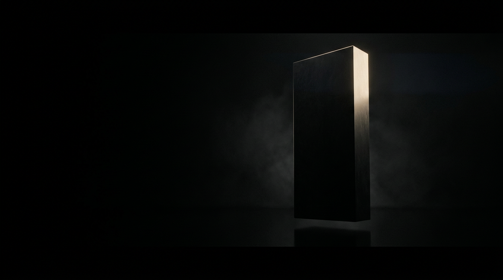
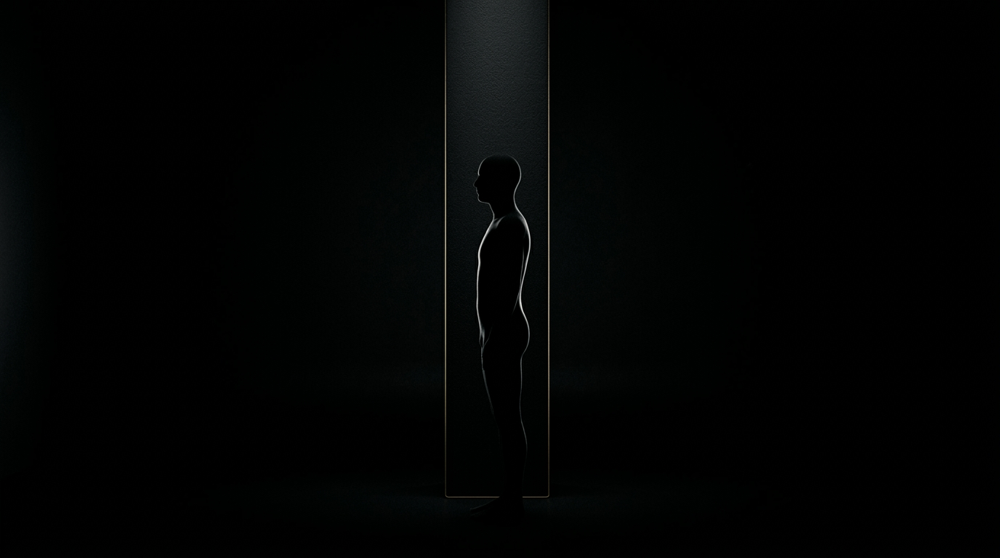
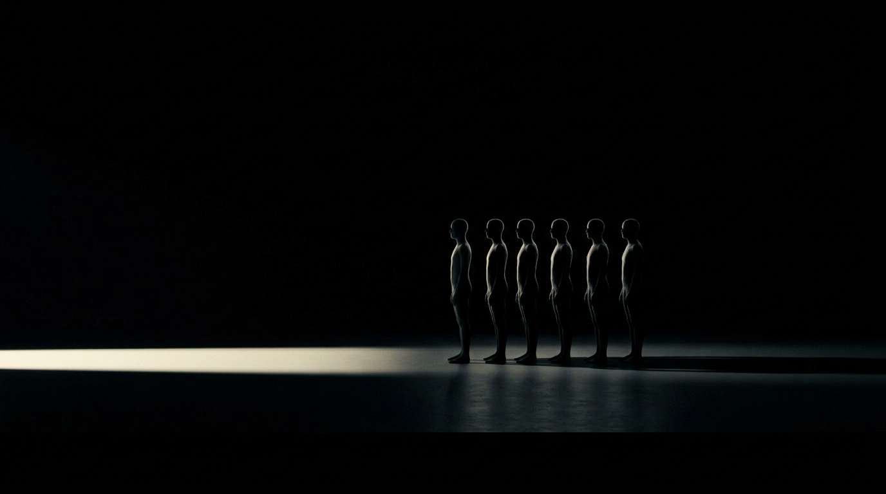

# Storyboard — Direito Administrativo: Agentes Públicos

**Formato:** Storyboard de 10 cenas horizontais (16:9) + 2 cenas extras · **Versão:** 1.0
**Direção de arte:** minimalista profissional, fundo preto dominante, zero texto na imagem.

Uma sequência pensada para ser projetada em slides 16:9 durante uma aula expositiva.
Cada cena é um objeto visual único, isolado no escuro, que **traduz um instituto jurídico
sem literalidade e sem palavras** — o texto do slide entra por cima, na edição.

---

## 1. Linguagem visual (regras que valem para todas as cenas)

| Elemento | Definição |
|---|---|
| Fundo | preto absoluto (#000000) ocupando 85% a 90% do quadro |
| Paleta | `#000000` · `#0B0B0C` · `#1C1C1E` · `#EDE6DA` · `#C6A664` |
| Luz | fonte única, contraluz lateral ou feixe cenital, chiaroscuro duro, névoa volumétrica discreta |
| Materiais | pedra preta fosca, concreto, vidro fumê, bronze escovado, cristal |
| Acabamento | grão fino de filme 35mm, textura mate, alto contraste, zero saturação fora do latão |
| Regra absoluta | nenhum texto, letra, número, logotipo, símbolo legível, rosto ou documento com escrita |
| Composição | muito espaço negativo, simetria ou regra dos terços, sujeito isolado, horizonte limpo |

**Cauda de estilo** (cole no fim de qualquer prompt para manter a unidade da série):

> Minimalist professional editorial art direction, predominantly pure black background occupying 85 to 90 percent of the frame, single controlled light source, deep chiaroscuro, subtle volumetric haze, matte surfaces, restrained palette of black, charcoal and ivory with one hairline of brushed warm brass, high contrast, generous negative space, cinematic architectural still life, 35mm anamorphic lens, f/2.8, fine film grain, no text anywhere in the image.

**Por que preto e sem texto:** o fundo preto elimina ruído e mantém o foco na ideia;
a ausência de texto evita conflito tipográfico com a fala do professor e permite
reaproveitar a mesma imagem em qualquer idioma ou versão do material.

---

## 2. Roteiro da sequência

| # | Cena | Conceito jurídico | Objeto visual | Tela | Transição |
|---|---|---|---|---|---|
| 1 | **Abertura — o Estado como abstração** | A pessoa jurídica de direito público é uma abstração: o Estado só existe, na prática, quando alguém age por ele. | Monólito de pedra preta com apenas uma aresta iluminada | 8s | fade in a partir do preto, 1,2 s |
| 2 | **Teoria do órgão — o agente é o corpo do Estado** | Teoria do órgão (imputação): a vontade do agente é imputada ao Estado, como se o Estado agisse por meio dele. | Silhueta humana alinhada a uma coluna, formando um único corpo | 9s | crossfade 0,8 s |
| 3 | **Investidura — o vínculo jurídico** | O agente público só age legitimamente porque está investido em cargo, emprego ou função, por um vínculo jurídico previamente definido. | Cadeira vazia sob um fio de latão que desce da escuridão | 7s | corte seco no preto |
| 4 | **Princípio da legalidade** | Ao agente público só é lícito fazer o que a lei autoriza (art. 37, caput, da CF/88). | Fio de prumo de luz e grade ortogonal perfeita | 8s | crossfade 0,6 s |
| 5 | **Hierarquia e subordinação** | Poder hierárquico: escalonamento, fiscalização e revisão da atuação do subordinado. | Degraus de pedra que sobem e desaparecem no preto | 7s | corte seco |
| 6 | **Impessoalidade** | O agente atua em nome da função, não em nome próprio: vedação de promoção pessoal e de favorecimento. | Fileira de silhuetas idênticas, iluminadas de forma idêntica | 9s | crossfade 0,8 s |
| 7 | **Moralidade e ética** | A atuação deve observar boa-fé, lealdade, probidade e coerência (moralidade administrativa). | Prisma de cristal atravessado por um único feixe | 8s | crossfade 0,6 s |
| 8 | **Publicidade e transparência** | Publicidade é regra; sigilo é exceção (art. 37, caput, e art. 5º, XXXIII, da CF/88; Lei 12.527/2011). | Feixe cônico atravessando um painel de vidro fumê | 8s | corte seco |
| 9 | **Responsabilidade** | O agente responde civil, penal e administrativamente por seus atos; o Estado responde objetivamente pelos danos que seus agentes causarem (art. 37, § 6º, da CF/88). | Peso de bronze cuja sombra é maior que o objeto | 9s | crossfade 0,8 s |
| 10 | **Fechamento — o serviço continua** | Continuidade do serviço público e permanência da função: o agente passa, a instituição fica. | Porta entreaberta vazando uma linha de luz | 10s | fade out para o preto, 2 s |
| 11 | **Eficiência (cena extra)** | Eficiência como dever de resultado e de economicidade na atuação administrativa. | Metrônomo mínimo, agulha única em movimento | 6s | corte seco |
| 12 | **Continuidade do serviço (cena extra)** | Continuidade do serviço público: a prestação não pode ser interrompida (art. 6º, § 1º, Lei 8.987/1995, por analogia). | Canal de luz correndo entre blocos de pedra | 7s | crossfade 0,8 s |

Sequência principal (cenas 1 a 10): **83 segundos** de imagem em tela. As cenas 11 e 12 são extras, para encaixar conforme o recorte da aula.

### Prévias de direção de arte

Três cenas foram geradas como teste da linguagem visual (as demais seguem exatamente
a mesma receita de luz, paleta e lente).

| Cena 01 | Cena 02 | Cena 06 |
|---|---|---|
|  |  |  |


---

## 3. Prompts em JSON

Cada objeto abaixo é autossuficiente: pode ser copiado isoladamente para um
pipeline, uma API ou uma planilha de produção. O campo `prompt` é o texto que
vai para o modelo; os demais campos são metadados de direção e de roteiro.

### 01. Abertura — o Estado como abstração

- **Conceito:** A pessoa jurídica de direito público é uma abstração: o Estado só existe, na prática, quando alguém age por ele.
- **Objeto visual:** Monólito de pedra preta com apenas uma aresta iluminada
- **Deixa de fala:** Abra a aula com a pergunta: quando o Estado age, quem exatamente está agindo?
- **Especificação:** 16:9 · 3840x2160 · png · área livre para texto: metade esquerda inferior
- **Tela / transição:** 8s · fade in a partir do preto, 1,2 s
- **Nota de uso:** Cena de capa. Não escurecer demais na pós: a aresta iluminada precisa aparecer mesmo em projetor de baixo contraste.

```json
{
  "id": "cena-01",
  "ordem": 1,
  "titulo": "Abertura — o Estado como abstração",
  "conceito_juridico": "A pessoa jurídica de direito público é uma abstração: o Estado só existe, na prática, quando alguém age por ele.",
  "objeto_visual": "Monólito de pedra preta com apenas uma aresta iluminada",
  "gancho_de_fala": "Abra a aula com a pergunta: quando o Estado age, quem exatamente está agindo?",
  "duracao_em_tela_s": 8,
  "transicao": "fade in a partir do preto, 1,2 s",
  "especificacoes": {
    "proporcao": "16:9",
    "resolucao": "3840x2160",
    "formato": "png",
    "area_livre_para_texto": "metade esquerda inferior"
  },
  "prompt": "A massive matte black stone monolith with razor-sharp edges standing alone in an infinite black void, floating above a black reflective floor, only its upper right vertical edge catching a hairline of warm ivory light, a faint wisp of volumetric haze drifting behind it, 88 percent of the frame pure black, extreme negative space on the left, symmetrical horizon, no visible room, minimalist architectural still life, cinematic chiaroscuro, 35mm anamorphic lens, f/2.8, fine film grain, monochrome black and charcoal palette with a single brushed brass highlight, high contrast, no text, no letters, no logos, no people.",
  "negative_prompt": "text, letters, numbers, words, typography, watermark, logo, signature, signage, labels, readable documents, faces, crowd, clutter, bright background, white background, grey studio background, rainbow colors, neon, multiple light sources, flat lighting, low contrast, oversaturated, chrome, plastic, 3d render look, cartoon, illustration, stock photo, blurry, low resolution",
  "parametros_por_ferramenta": {
    "midjourney": "--ar 16:9 --style raw --v 6.1 --stylize 150 --no text letters words logo",
    "flux_sd": "width 1920, height 1088, guidance 3.5, steps 32, sampler dpmpp_2m",
    "dalle_gpt_image": "gerar em paisagem 16:9, sem qualquer texto"
  },
  "texto_na_imagem": false,
  "paleta_dominante": [
    "#000000",
    "#0B0B0C",
    "#EDE6DA",
    "#C6A664"
  ],
  "notas_de_uso": "Cena de capa. Não escurecer demais na pós: a aresta iluminada precisa aparecer mesmo em projetor de baixo contraste."
}
```

### 02. Teoria do órgão — o agente é o corpo do Estado

- **Conceito:** Teoria do órgão (imputação): a vontade do agente é imputada ao Estado, como se o Estado agisse por meio dele.
- **Objeto visual:** Silhueta humana alinhada a uma coluna, formando um único corpo
- **Deixa de fala:** O agente não representa o Estado: ele é o Estado em atuação.
- **Especificação:** 16:9 · 3840x2160 · png · área livre para texto: terço inferior
- **Tela / transição:** 9s · crossfade 0,8 s
- **Nota de uso:** Se a figura sair com rosto reconhecível, reforçar no prompt 'backlit silhouette, no facial features' ou gerar de costas.

```json
{
  "id": "cena-02",
  "ordem": 2,
  "titulo": "Teoria do órgão — o agente é o corpo do Estado",
  "conceito_juridico": "Teoria do órgão (imputação): a vontade do agente é imputada ao Estado, como se o Estado agisse por meio dele.",
  "objeto_visual": "Silhueta humana alinhada a uma coluna, formando um único corpo",
  "gancho_de_fala": "O agente não representa o Estado: ele é o Estado em atuação.",
  "duracao_em_tela_s": 9,
  "transicao": "crossfade 0,8 s",
  "especificacoes": {
    "proporcao": "16:9",
    "resolucao": "3840x2160",
    "formato": "png",
    "area_livre_para_texto": "terço inferior"
  },
  "prompt": "A tall matte black architectural column standing in total darkness, and directly in front of it a featureless human silhouette in profile, perfectly aligned so that the person and the column read as one single vertical form, a soft rim light from the left tracing only the contour of both, the figure anonymous and faceless, shoulders inside the column line, 85 percent of the frame pure black, thin brass line of light along the outer edge, cinematic chiaroscuro, 35mm anamorphic lens, f/2.8, fine film grain, minimalist professional editorial art direction, no text, no letters, no logos, no facial features.",
  "negative_prompt": "text, letters, numbers, typography, watermark, logo, readable documents, detailed face, eyes, crowd, bright background, white background, colored light, multiple light sources, flat lighting, oversaturated, chrome, plastic 3d render, cartoon, stock photo, blurry",
  "parametros_por_ferramenta": {
    "midjourney": "--ar 16:9 --style raw --v 6.1 --stylize 150 --no text letters words logo face",
    "flux_sd": "width 1920, height 1088, guidance 3.5, steps 32",
    "dalle_gpt_image": "gerar em paisagem 16:9, sem texto"
  },
  "texto_na_imagem": false,
  "paleta_dominante": [
    "#000000",
    "#111113",
    "#EDE6DA"
  ],
  "notas_de_uso": "Se a figura sair com rosto reconhecível, reforçar no prompt 'backlit silhouette, no facial features' ou gerar de costas."
}
```

### 03. Investidura — o vínculo jurídico

- **Conceito:** O agente público só age legitimamente porque está investido em cargo, emprego ou função, por um vínculo jurídico previamente definido.
- **Objeto visual:** Cadeira vazia sob um fio de latão que desce da escuridão
- **Deixa de fala:** Sem investidura não há agente: há apenas alguém ocupando uma cadeira.
- **Especificação:** 16:9 · 3840x2160 · png · área livre para texto: lateral direita
- **Tela / transição:** 7s · corte seco no preto
- **Nota de uso:** A cadeira deve permanecer vazia — é a metáfora do cargo, não da pessoa.

```json
{
  "id": "cena-03",
  "ordem": 3,
  "titulo": "Investidura — o vínculo jurídico",
  "conceito_juridico": "O agente público só age legitimamente porque está investido em cargo, emprego ou função, por um vínculo jurídico previamente definido.",
  "objeto_visual": "Cadeira vazia sob um fio de latão que desce da escuridão",
  "gancho_de_fala": "Sem investidura não há agente: há apenas alguém ocupando uma cadeira.",
  "duracao_em_tela_s": 7,
  "transicao": "corte seco no preto",
  "especificacoes": {
    "proporcao": "16:9",
    "resolucao": "3840x2160",
    "formato": "png",
    "area_livre_para_texto": "lateral direita"
  },
  "prompt": "A single austere black wooden chair placed at the exact center of an infinite dark room, lit by one narrow overhead shaft of ivory light, a single taut brass thread descending from the darkness above and attaching to the top of the chair backrest, dust motes suspended in the beam, the floor barely visible as a black mirror, chair empty, 87 percent of the frame pure black, symmetrical composition, cinematic chiaroscuro, 35mm anamorphic lens, f/2.8, fine film grain, minimalist professional editorial art direction, no text, no letters, no logos, no person seated.",
  "negative_prompt": "text, letters, numbers, typography, watermark, logo, person, seated figure, bright background, white background, furniture showroom, clutter, multiple light sources, flat lighting, warm color cast, oversaturated, chrome, cartoon, stock photo, blurry",
  "parametros_por_ferramenta": {
    "midjourney": "--ar 16:9 --style raw --v 6.1 --stylize 150 --no text letters words logo person",
    "flux_sd": "width 1920, height 1088, guidance 3.5, steps 32",
    "dalle_gpt_image": "gerar em paisagem 16:9, sem texto"
  },
  "texto_na_imagem": false,
  "paleta_dominante": [
    "#000000",
    "#151515",
    "#EDE6DA",
    "#C6A664"
  ],
  "notas_de_uso": "A cadeira deve permanecer vazia — é a metáfora do cargo, não da pessoa."
}
```

### 04. Princípio da legalidade

- **Conceito:** Ao agente público só é lícito fazer o que a lei autoriza (art. 37, caput, da CF/88).
- **Objeto visual:** Fio de prumo de luz e grade ortogonal perfeita
- **Deixa de fala:** A legalidade não é um limite externo: é a própria estrutura que sustenta o agir.
- **Especificação:** 16:9 · 3840x2160 · png · área livre para texto: canto superior esquerdo
- **Tela / transição:** 8s · crossfade 0,6 s
- **Nota de uso:** Ideal para slide de abertura do bloco de princípios. Aceita texto sobreposto no canto superior esquerdo.

```json
{
  "id": "cena-04",
  "ordem": 4,
  "titulo": "Princípio da legalidade",
  "conceito_juridico": "Ao agente público só é lícito fazer o que a lei autoriza (art. 37, caput, da CF/88).",
  "objeto_visual": "Fio de prumo de luz e grade ortogonal perfeita",
  "gancho_de_fala": "A legalidade não é um limite externo: é a própria estrutura que sustenta o agir.",
  "duracao_em_tela_s": 8,
  "transicao": "crossfade 0,6 s",
  "especificacoes": {
    "proporcao": "16:9",
    "resolucao": "3840x2160",
    "formato": "png",
    "area_livre_para_texto": "canto superior esquerdo"
  },
  "prompt": "A perfectly straight vertical plumb line of ivory light, one pixel wide, hanging in infinite black space slightly off center, behind it a faint orthogonal grid of hairline brass lines receding in exact perspective, every intersection aligned to the plumb line with mathematical precision, almost nothing else visible, 90 percent of the frame pure black, dust in the air catching the beam, graphic minimalism, cinematic chiaroscuro, 35mm lens, f/4, fine film grain, no text, no letters, no numbers, no logos.",
  "negative_prompt": "text, letters, numbers, typography, formulas, watermark, logo, wireframe render, hud interface, blueprint labels, bright background, white background, colored neon grid, multiple light sources, lens flare chaos, oversaturated, cartoon, stock photo, blurry",
  "parametros_por_ferramenta": {
    "midjourney": "--ar 16:9 --style raw --v 6.1 --stylize 100 --no text letters numbers grid labels",
    "flux_sd": "width 1920, height 1088, guidance 3.0, steps 32",
    "dalle_gpt_image": "gerar em paisagem 16:9, sem texto"
  },
  "texto_na_imagem": false,
  "paleta_dominante": [
    "#000000",
    "#0E0E0F",
    "#EDE6DA",
    "#C6A664"
  ],
  "notas_de_uso": "Ideal para slide de abertura do bloco de princípios. Aceita texto sobreposto no canto superior esquerdo."
}
```

### 05. Hierarquia e subordinação

- **Conceito:** Poder hierárquico: escalonamento, fiscalização e revisão da atuação do subordinado.
- **Objeto visual:** Degraus de pedra que sobem e desaparecem no preto
- **Deixa de fala:** Hierarquia é estrutura, não privilégio: cada nível responde ao de cima.
- **Especificação:** 16:9 · 3840x2160 · png · área livre para texto: terço inferior
- **Tela / transição:** 7s · corte seco
- **Nota de uso:** Boa cena de transição: a subida visual prepara o espectador para o próximo conceito.

```json
{
  "id": "cena-05",
  "ordem": 5,
  "titulo": "Hierarquia e subordinação",
  "conceito_juridico": "Poder hierárquico: escalonamento, fiscalização e revisão da atuação do subordinado.",
  "objeto_visual": "Degraus de pedra que sobem e desaparecem no preto",
  "gancho_de_fala": "Hierarquia é estrutura, não privilégio: cada nível responde ao de cima.",
  "duracao_em_tela_s": 7,
  "transicao": "corte seco",
  "especificacoes": {
    "proporcao": "16:9",
    "resolucao": "3840x2160",
    "formato": "png",
    "area_livre_para_texto": "terço inferior"
  },
  "prompt": "A flight of massive black stone steps ascending diagonally from lower left to upper right and vanishing into absolute darkness, each step edge defined only by a hairline of warm ivory light, no handrail, no walls, no railing, perfectly regular proportions, 86 percent of the frame pure black, faint haze at the top of the stair, cinematic chiaroscuro, 35mm anamorphic lens, f/2.8, fine film grain, minimalist architectural photography, no text, no letters, no logos, no people.",
  "negative_prompt": "text, letters, numbers, typography, watermark, logo, marble palace, ornate architecture, columns galore, people, bright background, white background, colored light, multiple light sources, flat lighting, oversaturated, cartoon, stock photo, blurry",
  "parametros_por_ferramenta": {
    "midjourney": "--ar 16:9 --style raw --v 6.1 --stylize 150 --no text letters words logo people",
    "flux_sd": "width 1920, height 1088, guidance 3.5, steps 32",
    "dalle_gpt_image": "gerar em paisagem 16:9, sem texto"
  },
  "texto_na_imagem": false,
  "paleta_dominante": [
    "#000000",
    "#141416",
    "#EDE6DA"
  ],
  "notas_de_uso": "Boa cena de transição: a subida visual prepara o espectador para o próximo conceito."
}
```

### 06. Impessoalidade

- **Conceito:** O agente atua em nome da função, não em nome próprio: vedação de promoção pessoal e de favorecimento.
- **Objeto visual:** Fileira de silhuetas idênticas, iluminadas de forma idêntica
- **Deixa de fala:** Se não é possível distinguir quem é quem, a decisão é impessoal.
- **Especificação:** 16:9 · 3840x2160 · png · área livre para texto: faixa superior
- **Tela / transição:** 9s · crossfade 0,8 s
- **Nota de uso:** Cena-chave da aula. Evitar que a IA gere uniformes ou insígnias — reforçar 'no badges, no uniforms'.

```json
{
  "id": "cena-06",
  "ordem": 6,
  "titulo": "Impessoalidade",
  "conceito_juridico": "O agente atua em nome da função, não em nome próprio: vedação de promoção pessoal e de favorecimento.",
  "objeto_visual": "Fileira de silhuetas idênticas, iluminadas de forma idêntica",
  "gancho_de_fala": "Se não é possível distinguir quem é quem, a decisão é impessoal.",
  "duracao_em_tela_s": 9,
  "transicao": "crossfade 0,8 s",
  "especificacoes": {
    "proporcao": "16:9",
    "resolucao": "3840x2160",
    "formato": "png",
    "area_livre_para_texto": "faixa superior"
  },
  "prompt": "Six identical featureless human silhouettes standing shoulder to shoulder in profile on a black plane, evenly lit by one long horizontal strip of ivory light from the left so that they are completely indistinguishable from one another, their shadows merging into a single continuous dark band on the floor, no faces, no clothing detail, no accessories, 85 percent of the frame pure black, extreme wide composition with negative space above, cinematic chiaroscuro, 35mm anamorphic lens, f/2.8, fine film grain, minimalist professional editorial art direction, no text, no letters, no numbers, no logos.",
  "negative_prompt": "text, letters, numbers, typography, watermark, logo, visible faces, uniforms with badges, distinct individuals, crowd chaos, bright background, white background, color separation, multiple light sources, flat lighting, oversaturated, cartoon, stock photo, blurry",
  "parametros_por_ferramenta": {
    "midjourney": "--ar 16:9 --style raw --v 6.1 --stylize 120 --no text letters words logo faces",
    "flux_sd": "width 1920, height 1088, guidance 3.5, steps 32",
    "dalle_gpt_image": "gerar em paisagem 16:9, sem texto"
  },
  "texto_na_imagem": false,
  "paleta_dominante": [
    "#000000",
    "#101012",
    "#EDE6DA"
  ],
  "notas_de_uso": "Cena-chave da aula. Evitar que a IA gere uniformes ou insígnias — reforçar 'no badges, no uniforms'."
}
```

### 07. Moralidade e ética

- **Conceito:** A atuação deve observar boa-fé, lealdade, probidade e coerência (moralidade administrativa).
- **Objeto visual:** Prisma de cristal atravessado por um único feixe
- **Deixa de fala:** A lei diz o que pode; a moralidade diz como se deve.
- **Especificação:** 16:9 · 3840x2160 · png · área livre para texto: metade direita
- **Tela / transição:** 8s · crossfade 0,6 s
- **Nota de uso:** O espectro deve ficar quase todo absorvido pelo preto — não é para virar capa de disco de rock progressivo.

```json
{
  "id": "cena-07",
  "ordem": 7,
  "titulo": "Moralidade e ética",
  "conceito_juridico": "A atuação deve observar boa-fé, lealdade, probidade e coerência (moralidade administrativa).",
  "objeto_visual": "Prisma de cristal atravessado por um único feixe",
  "gancho_de_fala": "A lei diz o que pode; a moralidade diz como se deve.",
  "duracao_em_tela_s": 8,
  "transicao": "crossfade 0,6 s",
  "especificacoes": {
    "proporcao": "16:9",
    "resolucao": "3840x2160",
    "formato": "png",
    "area_livre_para_texto": "metade direita"
  },
  "prompt": "A single flawless crystal prism standing upright on a black mirrored surface in total darkness, pierced by one razor-thin beam of ivory light entering from the left, the light bending and separating into a very restrained warm brass and pale ivory spectrum that fades immediately into the blackness, tiny dust motes in the beam, 88 percent of the frame pure black, elegant and austere, cinematic chiaroscuro, macro-style 35mm lens at f/2.8, fine film grain, no text, no letters, no logos, no rainbow neon.",
  "negative_prompt": "text, letters, numbers, typography, watermark, logo, prism pyramid diagram, double rainbow, neon spectrum, rainbow colors, bright background, white background, multiple light sources, flat lighting, oversaturated, chrome, cartoon, stock photo, blurry",
  "parametros_por_ferramenta": {
    "midjourney": "--ar 16:9 --style raw --v 6.1 --stylize 100 --no text letters words logo rainbow",
    "flux_sd": "width 1920, height 1088, guidance 3.5, steps 32",
    "dalle_gpt_image": "gerar em paisagem 16:9, sem texto"
  },
  "texto_na_imagem": false,
  "paleta_dominante": [
    "#000000",
    "#0D0D0E",
    "#EDE6DA",
    "#C6A664"
  ],
  "notas_de_uso": "O espectro deve ficar quase todo absorvido pelo preto — não é para virar capa de disco de rock progressivo."
}
```

### 08. Publicidade e transparência

- **Conceito:** Publicidade é regra; sigilo é exceção (art. 37, caput, e art. 5º, XXXIII, da CF/88; Lei 12.527/2011).
- **Objeto visual:** Feixe cônico atravessando um painel de vidro fumê
- **Deixa de fala:** O que o feixe não alcança ainda existe — e por isso precisa ser justificado.
- **Especificação:** 16:9 · 3840x2160 · png · área livre para texto: terço inferior
- **Tela / transição:** 8s · corte seco
- **Nota de uso:** Ponto de atenção: se a IA colocar algo 'escrito' no painel de vidro, descartar a geração.

```json
{
  "id": "cena-08",
  "ordem": 8,
  "titulo": "Publicidade e transparência",
  "conceito_juridico": "Publicidade é regra; sigilo é exceção (art. 37, caput, e art. 5º, XXXIII, da CF/88; Lei 12.527/2011).",
  "objeto_visual": "Feixe cônico atravessando um painel de vidro fumê",
  "gancho_de_fala": "O que o feixe não alcança ainda existe — e por isso precisa ser justificado.",
  "duracao_em_tela_s": 8,
  "transicao": "corte seco",
  "especificacoes": {
    "proporcao": "16:9",
    "resolucao": "3840x2160",
    "formato": "png",
    "area_livre_para_texto": "terço inferior"
  },
  "prompt": "A narrow conical beam of ivory light from an unseen source cutting diagonally through an empty dark room and landing on a large smoked glass panel, the beam revealing only dust suspended in the air and the subtle edge of the glass outlined in a hairline of brushed brass, everything outside the beam swallowed by absolute black, 87 percent of the frame pure black, volumetric light, cinematic chiaroscuro, 35mm anamorphic lens, f/2.8, fine film grain, minimalist professional editorial art direction, no text, no letters, no numbers, no logos, no doors with signs.",
  "negative_prompt": "text, letters, numbers, typography, watermark, logo, projected words, slides, screens with content, documents, bright background, white background, colored light beams, multiple projectors, lens flares, flat lighting, oversaturated, cartoon, stock photo, blurry",
  "parametros_por_ferramenta": {
    "midjourney": "--ar 16:9 --style raw --v 6.1 --stylize 120 --no text letters words logo screen",
    "flux_sd": "width 1920, height 1088, guidance 3.5, steps 32",
    "dalle_gpt_image": "gerar em paisagem 16:9, sem texto"
  },
  "texto_na_imagem": false,
  "paleta_dominante": [
    "#000000",
    "#0F1113",
    "#EDE6DA",
    "#C6A664"
  ],
  "notas_de_uso": "Ponto de atenção: se a IA colocar algo 'escrito' no painel de vidro, descartar a geração."
}
```

### 09. Responsabilidade

- **Conceito:** O agente responde civil, penal e administrativamente por seus atos; o Estado responde objetivamente pelos danos que seus agentes causarem (art. 37, § 6º, da CF/88).
- **Objeto visual:** Peso de bronze cuja sombra é maior que o objeto
- **Deixa de fala:** A sombra do ato é sempre maior do que o ato.
- **Especificação:** 16:9 · 3840x2160 · png · área livre para texto: metade esquerda
- **Tela / transição:** 9s · crossfade 0,8 s
- **Nota de uso:** Fuja do clichê de martelo de juiz: o peso e a sombra comunicam responsabilidade sem literalidade.

```json
{
  "id": "cena-09",
  "ordem": 9,
  "titulo": "Responsabilidade",
  "conceito_juridico": "O agente responde civil, penal e administrativamente por seus atos; o Estado responde objetivamente pelos danos que seus agentes causarem (art. 37, § 6º, da CF/88).",
  "objeto_visual": "Peso de bronze cuja sombra é maior que o objeto",
  "gancho_de_fala": "A sombra do ato é sempre maior do que o ato.",
  "duracao_em_tela_s": 9,
  "transicao": "crossfade 0,8 s",
  "especificacoes": {
    "proporcao": "16:9",
    "resolucao": "3840x2160",
    "formato": "png",
    "area_livre_para_texto": "metade esquerda"
  },
  "prompt": "A single matte black bronze weight resting on a low black pedestal in an empty dark room, hard single light from the upper right casting a shadow twice as long as the object and denser than the object itself, stretching across the black floor, a slack thin brass chain coiled beside it, no scale or number markings, 86 percent of the frame pure black, dramatic isolation, cinematic chiaroscuro, 35mm anamorphic lens, f/2.8, fine film grain, minimalist professional editorial art direction, no text, no letters, no numbers, no logos.",
  "negative_prompt": "text, letters, numbers, scales with markings, watermark, logo, courtroom gavel cliché, handcuffs, bright background, white background, multiple light sources, flat lighting, oversaturated, chrome, cartoon, stock photo, blurry",
  "parametros_por_ferramenta": {
    "midjourney": "--ar 16:9 --style raw --v 6.1 --stylize 120 --no text letters numbers words logo",
    "flux_sd": "width 1920, height 1088, guidance 3.5, steps 32",
    "dalle_gpt_image": "gerar em paisagem 16:9, sem texto"
  },
  "texto_na_imagem": false,
  "paleta_dominante": [
    "#000000",
    "#121214",
    "#C6A664",
    "#EDE6DA"
  ],
  "notas_de_uso": "Fuja do clichê de martelo de juiz: o peso e a sombra comunicam responsabilidade sem literalidade."
}
```

### 10. Fechamento — o serviço continua

- **Conceito:** Continuidade do serviço público e permanência da função: o agente passa, a instituição fica.
- **Objeto visual:** Porta entreaberta vazando uma linha de luz
- **Deixa de fala:** Os agentes mudam; a função pública permanece.
- **Especificação:** 16:9 · 3840x2160 · png · área livre para texto: toda a moldura (cena de encerramento)
- **Tela / transição:** 10s · fade out para o preto, 2 s
- **Nota de uso:** Cena de encerramento: aceita os créditos e o contato do professor sobrepostos.

```json
{
  "id": "cena-10",
  "ordem": 10,
  "titulo": "Fechamento — o serviço continua",
  "conceito_juridico": "Continuidade do serviço público e permanência da função: o agente passa, a instituição fica.",
  "objeto_visual": "Porta entreaberta vazando uma linha de luz",
  "gancho_de_fala": "Os agentes mudam; a função pública permanece.",
  "duracao_em_tela_s": 10,
  "transicao": "fade out para o preto, 2 s",
  "especificacoes": {
    "proporcao": "16:9",
    "resolucao": "3840x2160",
    "formato": "png",
    "area_livre_para_texto": "toda a moldura (cena de encerramento)"
  },
  "prompt": "A black monolithic wall with a tall door barely ajar, a single vertical seam of warm ivory light escaping from the opening and falling onto a black floor as an elongated triangle, no handle visible, no signage, everything else absolute darkness, 90 percent of the frame pure black, quiet and monumental, volumetric haze in the light seam, cinematic chiaroscuro, 35mm anamorphic lens, f/2.8, fine film grain, minimalist professional editorial art direction, no text, no letters, no numbers, no logos, no exit sign.",
  "negative_prompt": "text, letters, numbers, exit sign, typography, watermark, logo, door handle detail, bright background, white background, corridor with lamps, multiple light sources, flat lighting, oversaturated, warm orange cast, cartoon, stock photo, blurry",
  "parametros_por_ferramenta": {
    "midjourney": "--ar 16:9 --style raw --v 6.1 --stylize 150 --no text letters exit sign logo",
    "flux_sd": "width 1920, height 1088, guidance 3.5, steps 32",
    "dalle_gpt_image": "gerar em paisagem 16:9, sem texto"
  },
  "texto_na_imagem": false,
  "paleta_dominante": [
    "#000000",
    "#0A0A0B",
    "#EDE6DA"
  ],
  "notas_de_uso": "Cena de encerramento: aceita os créditos e o contato do professor sobrepostos."
}
```

### 11. Eficiência (cena extra)

- **Conceito:** Eficiência como dever de resultado e de economicidade na atuação administrativa.
- **Objeto visual:** Metrônomo mínimo, agulha única em movimento
- **Deixa de fala:** Eficiência é ritmo: fazer o que deve ser feito, no tempo e no custo devidos.
- **Especificação:** 16:9 · 3840x2160 · png · área livre para texto: metade esquerda
- **Tela / transição:** 6s · corte seco
- **Nota de uso:** Use como pausa visual entre blocos. Se o metrônomo pedir números, substitua por um pêndulo simples.

```json
{
  "id": "extra-11",
  "ordem": 11,
  "titulo": "Eficiência (cena extra)",
  "conceito_juridico": "Eficiência como dever de resultado e de economicidade na atuação administrativa.",
  "objeto_visual": "Metrônomo mínimo, agulha única em movimento",
  "gancho_de_fala": "Eficiência é ritmo: fazer o que deve ser feito, no tempo e no custo devidos.",
  "duracao_em_tela_s": 6,
  "transicao": "corte seco",
  "especificacoes": {
    "proporcao": "16:9",
    "resolucao": "3840x2160",
    "formato": "png",
    "area_livre_para_texto": "metade esquerda"
  },
  "prompt": "A single slender black metronome standing on a black surface in an empty dark room, its metal needle caught mid-swing and rendered only by a thin line of ivory light, a faint motion trail suggesting rhythm, no numbers, no scale marks, no brand, 88 percent of the frame pure black, isolated and precise, cinematic chiaroscuro, 35mm macro lens at f/2.8, fine film grain, minimalist professional editorial art direction, no text, no letters, no numbers, no logos.",
  "negative_prompt": "text, letters, numbers, dial markings, watermark, logo, clock face with numerals, bright background, white background, multiple light sources, flat lighting, oversaturated, chrome, cartoon, stock photo, blurry",
  "parametros_por_ferramenta": {
    "midjourney": "--ar 16:9 --style raw --v 6.1 --stylize 120 --no text letters numbers logo",
    "flux_sd": "width 1920, height 1088, guidance 3.5, steps 32",
    "dalle_gpt_image": "gerar em paisagem 16:9, sem texto"
  },
  "texto_na_imagem": false,
  "paleta_dominante": [
    "#000000",
    "#131315",
    "#EDE6DA"
  ],
  "notas_de_uso": "Use como pausa visual entre blocos. Se o metrônomo pedir números, substitua por um pêndulo simples."
}
```

### 12. Continuidade do serviço (cena extra)

- **Conceito:** Continuidade do serviço público: a prestação não pode ser interrompida (art. 6º, § 1º, Lei 8.987/1995, por analogia).
- **Objeto visual:** Canal de luz correndo entre blocos de pedra
- **Deixa de fala:** O fluxo não pode parar — o agente é apenas o leito por onde ele corre.
- **Especificação:** 16:9 · 3840x2160 · png · área livre para texto: faixa superior
- **Tela / transição:** 7s · crossfade 0,8 s
- **Nota de uso:** Alternativa à cena 10 caso a apresentação termine falando de serviços públicos delegados.

```json
{
  "id": "extra-12",
  "ordem": 12,
  "titulo": "Continuidade do serviço (cena extra)",
  "conceito_juridico": "Continuidade do serviço público: a prestação não pode ser interrompida (art. 6º, § 1º, Lei 8.987/1995, por analogia).",
  "objeto_visual": "Canal de luz correndo entre blocos de pedra",
  "gancho_de_fala": "O fluxo não pode parar — o agente é apenas o leito por onde ele corre.",
  "duracao_em_tela_s": 7,
  "transicao": "crossfade 0,8 s",
  "especificacoes": {
    "proporcao": "16:9",
    "resolucao": "3840x2160",
    "formato": "png",
    "area_livre_para_texto": "faixa superior"
  },
  "prompt": "A narrow channel of liquid ivory light running horizontally between massive matte black stone blocks, seen in raking low angle, the light flowing continuously from the left edge to the right edge of the frame, black stone absorbing almost everything, faint mist above the channel, no water texture, abstract and sculptural, 85 percent of the frame pure black, cinematic chiaroscuro, 35mm anamorphic lens, f/2.8, fine film grain, minimalist professional editorial art direction, no text, no letters, no numbers, no logos.",
  "negative_prompt": "text, letters, numbers, typography, watermark, logo, river landscape, nature, bright background, white background, blue light, multiple light sources, flat lighting, oversaturated, cartoon, stock photo, blurry",
  "parametros_por_ferramenta": {
    "midjourney": "--ar 16:9 --style raw --v 6.1 --stylize 120 --no text letters words logo",
    "flux_sd": "width 1920, height 1088, guidance 3.5, steps 32",
    "dalle_gpt_image": "gerar em paisagem 16:9, sem texto"
  },
  "texto_na_imagem": false,
  "paleta_dominante": [
    "#000000",
    "#101011",
    "#EDE6DA",
    "#C6A664"
  ],
  "notas_de_uso": "Alternativa à cena 10 caso a apresentação termine falando de serviços públicos delegados."
}
```


---

## 4. Como gerar (passo a passo)

1. **Escolha o modelo** e cole o campo `prompt` da cena (não o JSON inteiro).
2. **Mantenha a receita fixa** entre as cenas: mesmo modelo, mesma versão, mesmo
   `seed` quando a ferramenta permitir (Midjourney: `--seed 1234`; Flux/SD: seed fixa).
   Consistência de série vem mais do *seed + paleta + lente* do que do assunto.
3. **Gere em 16:9 nativo** (1920×1088 ou maior). Não gere quadrado e corte depois:
   o enquadramento com muito espaço negativo se perde no recorte.
4. **Aplique o `negative_prompt`** sempre. Texto fantasma e marca d'água são os
   defeitos mais comuns neste tipo de imagem.
5. **Descarte e regenere** qualquer quadro com: letras/números legíveis, rosto
   reconhecível, fundo cinza ou branco, mais de uma fonte de luz, saturação colorida.
6. **Pós-produção mínima:** puxe o preto para `#000` puro (curvas), reduza a saturação
   global exceto no latão, adicione grão fino se o modelo entregar imagem "plástica".

### Consistência entre cenas

- Todas as cenas usam a mesma altura de horizonte e o mesmo tipo de lente (35mm).
- O latão (`#C6A664`) aparece em **no máximo 5% do quadro** — é acento, não cor.
- Nenhuma cena tem mais de um objeto protagonista.
- Reserve a área indicada em `area_livre_para_texto` para o título do slide.

### Checklist antes de fechar o deck

- [ ] 10 cenas geradas em 16:9, todas com fundo preto dominante
- [ ] Zero texto, letra, número, logo ou marca d'água em qualquer quadro
- [ ] Paleta unificada (preto + marfim + um fio de latão)
- [ ] Ordem narrativa: abstração → vínculo → princípios → responsabilidade → permanência
- [ ] Exportação em PNG (ou WebP de alta qualidade) para preservar o preto chapado
- [ ] Teste em projetor: a aresta/feixe de luz de cada cena precisa sobreviver ao contraste ruim

### Arquivos deste pacote

| Arquivo | Conteúdo |
|---|---|
| `prompts.json` | 12 prompts em JSON estruturado, prontos para consumo por script |
| `storyboard.md` | Este documento (gerado a partir do JSON) |
| `build_storyboard.py` | Script que regenera o Markdown a partir do JSON |
| `preview/` | Prévias geradas das cenas 01, 02 e 06 para validar a direção de arte |
